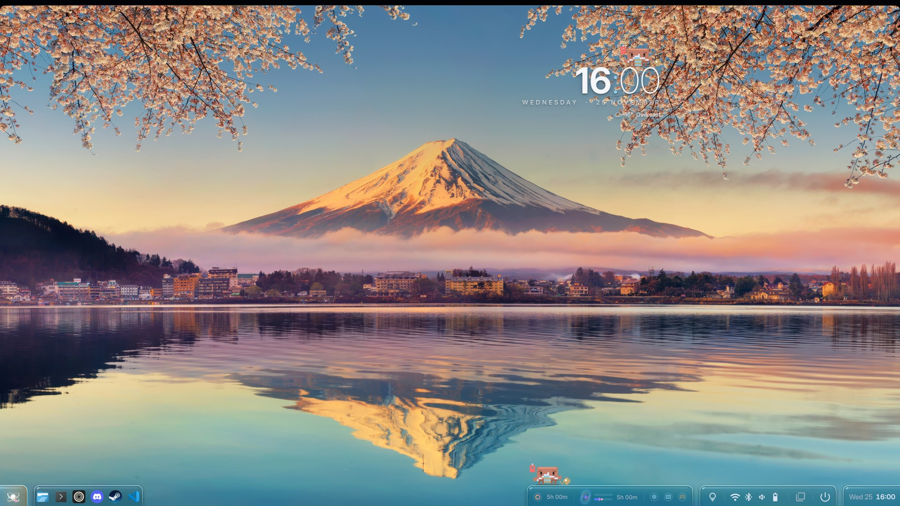
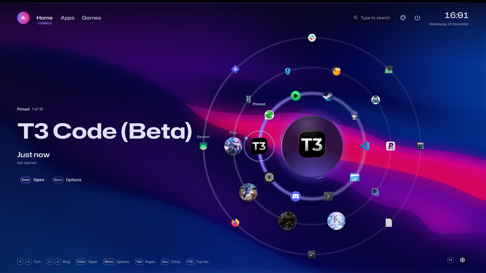
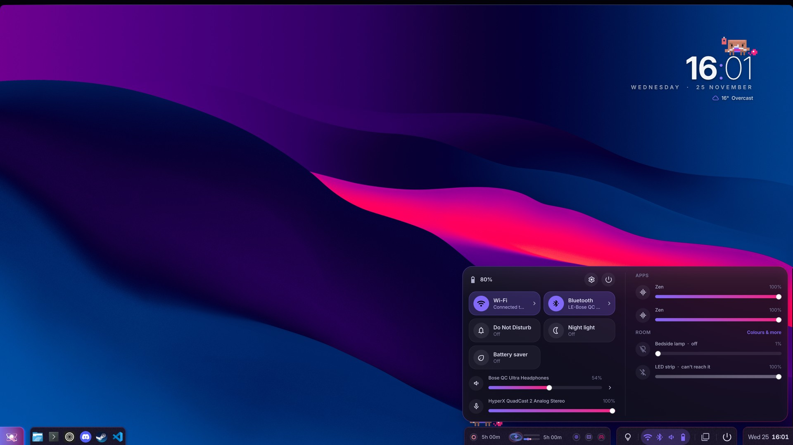
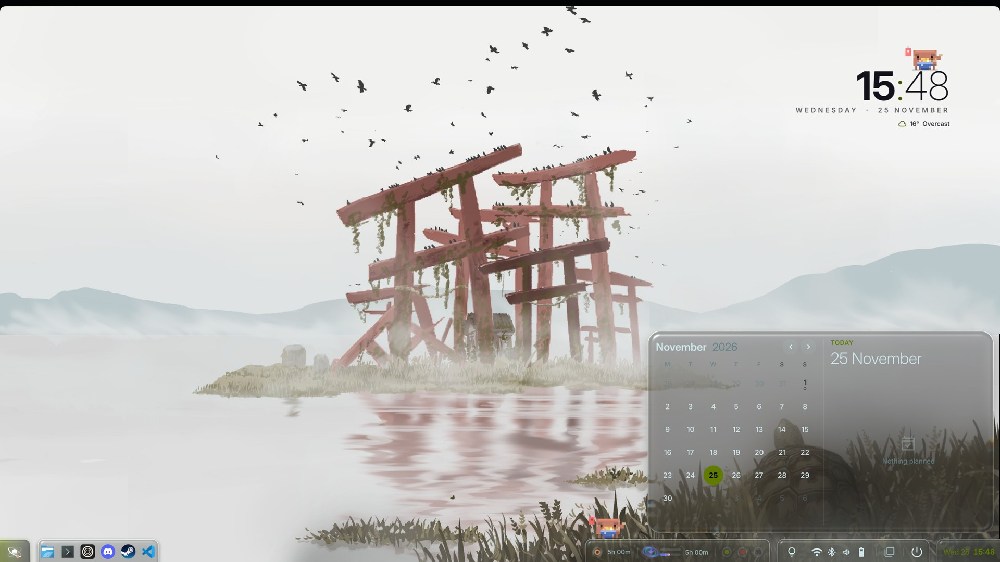
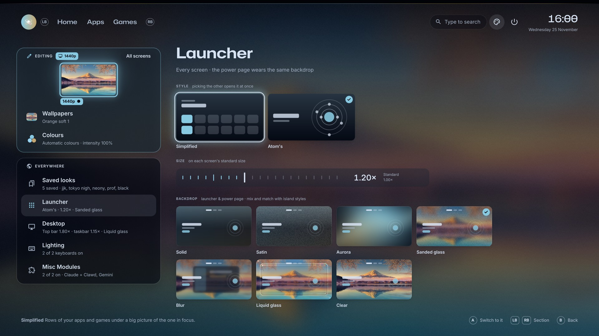
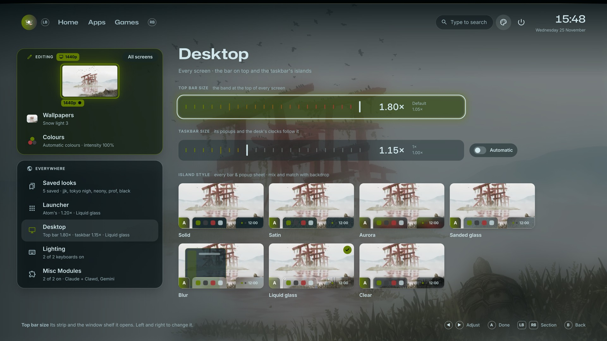
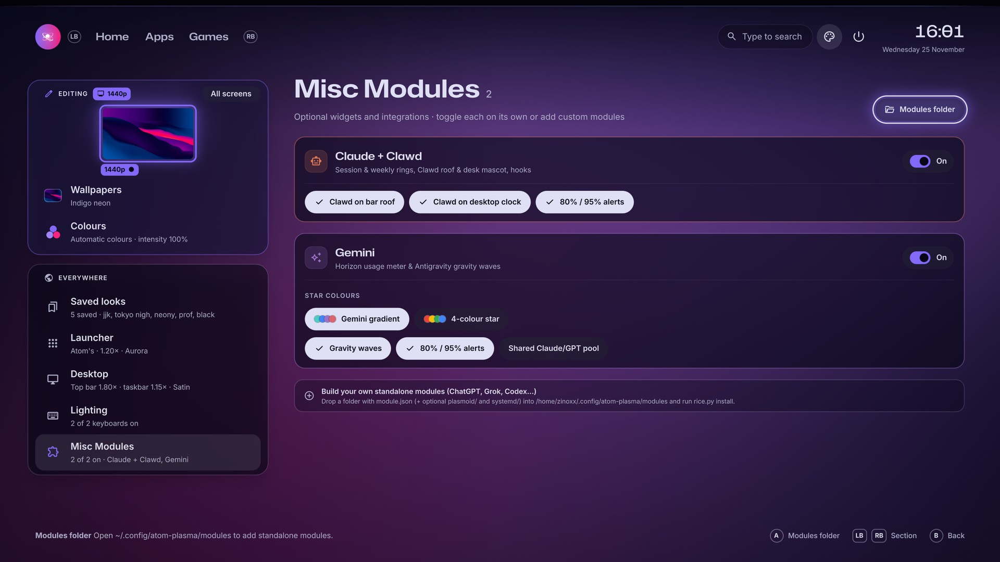

# Atom Plasma

A KDE Plasma 6 rice driven by the wallpaper. Every screen gets its own wallpaper and palette, and the desktop follows them: the colour scheme, Plasma Style, bar islands, optical glass materials, terminals, VS Code, Zen, window borders, the login screen and keyboard lighting. It's built to hold up on whatever is plugged in: one laptop panel, seven monitors, a portrait 4K next to an 8K and an 800×800 panel.

## Showcase



| Atom's Launcher · Liquid glass | Morphing Control Center · Satin islands |
| :---: | :---: |
|  |  |

| Morphing Calendar · Liquid glass | Theme Page — 7 Backdrop Materials · Sanded glass |
| :---: | :---: |
|  |  |

| Theme Page — Island Styles | Theme Page — Misc Modules · Aurora backdrop |
| :---: | :---: |
|  |  |

---

## Install

```sh
curl -fsSL https://raw.githubusercontent.com/Zinoxx0/Atom-Plasma/main/install.sh | sh
```

It checks the system first (KDE Plasma on Wayland, a Plasma version this release supports), installs what's missing (one password prompt; AUR packages build in a terminal you can watch; on non-Arch distros it lists them for you), takes the newest release on your channel and puts every piece in place. Then log out and back in, run `~/.config/plasma-rice/rice.py setup` once and `rice.py random` for a first wallpaper. `ATOM_CHANNEL=beta` (or `alpha`) before `sh` starts you on newer builds.

**Updates** come through Atom Manager (the gear at the launcher's bottom right). Releases are stable (`1.2.0`, fixes `1.2.1`), beta (`1.3.0-beta.1`) or alpha (`1.3.0-alpha.4`); a channel takes its own and every steadier one. An update keeps your build as a backup branch, installs what the new version needs, rebuilds what's compiled, restarts the shell, and goes back by itself if the desktop doesn't come back. A build with changes of your own asks first. A clone on any branch but `atom-release` is a developer copy: the updater reports releases but never touches it (`rice.py update` has the commands).

By hand (developers): clone anywhere, then `./rice.py install --dry-run`, `./rice.py install`, relog, `./rice.py setup`, `./rice.py random`, `./rice.py doctor`. `install` is safe to re-run and never overwrites files it didn't create; anything needing root is printed for you to run.

**Needs:** Plasma 6.8 on Wayland, Python 3 with Pillow, numpy, dbus-python and PyGObject, plus ImageMagick and Panel Colorizer; to build the shell's native module, CMake, Ninja, a C++20 compiler, `qt6-declarative` and `libdbusmenu-lxqt`. Optional: Darkly, Klassy, KWin better-blur-dx, Krohnkite (tiling), Claude Code and `jq` (Clawd & Claude usage module), Gemini CLI / T3 Code (Gemini usage & gravity waves module), `python-icalendar` and `python-recurring-ical-events` (Google Calendar), Limine and Plymouth (boot theming), Plasma Login Manager (login screen). *(Pre-compiled `.qsb` GPU shaders ship in the repo; `qt6-shadertools` is only needed if editing `.frag` sources.)*

---

## Surfaces & Materials

Both the **Launcher & Power Page backdrop** (`Theme → Launcher → Backdrop`) and the **Taskbar Islands & Morphing Popup Sheets** (`Theme → Desktop → Island style`) share the same 7 curated materials so you can mix and match freely:

| Material | Key | Description |
| :--- | :--- | :--- |
| **Solid** | `solid` | Clean architectural obsidian or sunlit alabaster tonal gradient matched to your screen's palette. Zero distraction. |
| **Satin** | `satin` | Bead-blasted anodized solid with a soft directional top sheen and fine tactile micro-grain (opaque, zero blur cost). |
| **Aurora** | `aurora` | Velvety multi-lobe ambient silk mesh woven smoothly from your wallpaper's `primary`, `secondary`, and `tertiary` accents with triangular-PDF dithering (zero 8-bit banding). |
| **Sanded glass** | `matte` | Softly frosted wallpaper under fine sandblasted grain — warm, architectural, zero banding. |
| **Blur** | `clear` | Clean real-time KWin blur of whatever sits behind, open windows included, lightly tinted and grain-free. |
| **Liquid glass** | `liquid` | Single-pass GPU optical glass: real **Snell's-law light refraction**, **Cauchy RGB chromatic dispersion**, curved plano-convex bevels, and **Schlick Fresnel** specular highlights over cached screen textures (**0% idle GPU**; zero extra blur passes). |
| **Clear** | `none` | Unfiltered sharp wallpaper with an adaptive contrast veil (launcher) or sleek translucent tint (islands). |

Set them live from the Theme page or the CLI:

```sh
rice.py backdrop solid|satin|aurora|matte|clear|liquid|none
rice.py bar style solid|satin|aurora|matte|clear|liquid|none
```

---

## Screens

- **Every screen gets the whole rice.** When screens are plugged in, unplugged, moved or rescaled, `atom-plasma-displayd` (a user unit that sleeps until KWin or udev reports a change) runs the reconciler. It gives a new screen the main screen's wallpaper, a desk clock, a bar and floating windows.
- **One set of islands, on the screen you're on.** Every screen has a bar, but the islands show on one at a time: the screen the pointer rests on, unless a fullscreen window (a game, a movie) covers it; then the free screen with the most pixels, the nearest on a tie (none at all when every screen is fullscreen). They follow the pointer at once, with a quick fade (`kwin/rice_islands`, a KWin script; hidden bars keep their place, so no window ever resizes). The islands are notches on the screen's bottom edge, rounded only at the top; the launcher jewel and the clock sit flush in the screen's corners. Five of them: the launcher, your Glimpse pins, the meters (enabled AI usage modules + CPU/RAM/GPU rings), the status island (tray apps, system state, tiling, power) and the clock.
- **The bar docks under a window.** When a window is maximized or touches the bar, the islands fuse smoothly over 260 ms into one full-width docked bar that meets the window's edge: gaps fill with the docked floor, corners straighten, and optical glass layers fade gracefully into the floor. When the window lets go, the islands separate again.
- **Bars fit their screen.** When a bar needs more room than its screen has (e.g. moving from a desk monitor to the laptop panel), pinned apps that don't fit fold into a folder tile that opens them in a popup, and come back as soon as there's room.
- **Monitors are known by their EDID** (maker, model, serial), not by connector. A monitor keeps its colours, size and place in your themes when it moves to another port (`./rice.py displays`).
- **Odd arrangements get flagged.** Overlapping or disconnected monitors are flagged with a notification and a one-click fix chip on the Theme page.
- **UI size is standardised.** Each screen gets the size that looks the same from where you sit (calculated from pixel density and viewing distance). The Theme page provides 0.05× tick sliders for Launcher size, Top bar size, and Taskbar size (Automatic per screen or uniform everywhere).

---

## Misc Modules (Claude, Gemini & Custom Extensions)

Optional AI & desktop integrations are standalone **modules** managed in **Theme → Misc Modules** or via `rice.py modules`. Turn any module on/off independently without affecting others — or drop your own custom module (ChatGPT, Grok, Codex, etc.) into `~/.config/atom-plasma/modules/<id>/` (see [modules/README.md](modules/README.md)).

### Claude + Clawd (`claude`)
The meters island (and the desk clock on one screen) hosts **Clawd**, Claude Code's pixel-art creature, alongside Claude's double usage ring and session reset timer. Clawd reflects what Claude Code is doing in real time (typing, thinking, running commands, reading, web search, delegating to subagents, compacting), tires as usage fills, and enjoys thirty seasonal/weather-aware hobbies off duty. On the bar, Clawd hops dynamically between the meters island roof (when space above is clear), inside the island (when occluded by a window), and inside the usage popup when open.

Clawd reads activity from Claude Code hooks (`rice.py install` wires `~/.claude/settings.json`) and usage limits from `bin/claude-statusline.sh` + the 5-minute `atom-plasma-claude-usage` timer (`bin/claude-usage.py`). Toggle roof mascot, desk clock mascot, and 80% / 95% alerts individually in **Theme → Misc Modules**.

### Gemini (`gemini`)
A minimalist Gemini-inspired usage widget sitting right alongside Claude on the meters island (or completely standalone if you don't use Claude):
- **Gemini 4-point star + horizon usage meter** showing your remaining quota and reset countdown (with a full per-model / Flash / Pro quota breakdown popup).
- **Selectable star palette:** switch live between **Gemini gradient** (iridescent violet→blue→cyan) and **4-colour star** (classic Google/Gemini four-point hues).
- **Antigravity gravity waves:** soft organic radial gravitational ripples emit around the star whenever Gemini / Antigravity is actively working — driven event-by-event via Gemini CLI hooks (`bin/gemini-hook.sh`) and live T3 Code session activity (`bin/t3-activity.py` watching T3 Code's SQLite WAL via `FileWatch`, 0% idle polling).

---

## The Shell

The bar's widgets are islands, and their panels all open on one morphing sheet per screen: it grows out of the island you clicked, glides smoothly to another island while you move along the bar, and folds back when it closes (`qml/Atom`, hosted by `com.zinoxx.shell` on every bar).

- **Launcher** (*Atom's* & *Simplified*, opened via the jewel or `Meta`): minimizes the current screen's windows into their pins and opens under the top band. **Atom's** arranges your apps as orbital rings around a glass core (up/down turns a ring, left/right steps rings, wheel turns, games as banners); **Simplified** presents rows of tiles under a hero banner. Typing searches immediately. The shared **Theme page** puts your live desk map, Wallpapers (sorted by accent hue with mood filters + built-in Wallhaven search), Colours, Saved looks, Launcher, Desktop, Lighting, and Misc Modules all on one screen.
- **Finder** (KRunner replacement): `Alt+Space`, `Alt+F2`, Search key, or typing on the bare desktop opens search on a floating frosted plate over your windows (`Alt+Shift+F2` searches the clipboard).
- **Atom Manager** (bottom-right gear, `F1`, or controller `View`): version & channel updater, `rice.py doctor` health checks with fixes, credits, and machine diagnostics.
- **Power** (power button on the status island or launcher): a circular backdrop ripple (with curved optical meniscus in Liquid glass) spreads across every monitor and presents session actions.
- **Game controller & On-Screen Keyboard** (`bin/pad.py`, `atom-plasma-pad` service): full couch/TV desktop control with D-pad/stick navigation, automatic pause while a game has focus, and a themed on-screen keyboard (`pkg/atom-pad-im` input method supporting full layouts & accents).
- **Status island, Notifications & Calendar**: replaces Plasma's system tray with stacked quiet icons, notification beads, a unified Control Center (Wi-Fi, Bluetooth, DND, night light, power profile, battery saver, per-app volume, per-screen brightness, media controls, and optional room-lights bridge), toast cards growing out of the status island, Portuguese holidays + Google Calendar (`bin/agenda.py`), and clipboard history on `Meta+V`.

---

## Features

Each feature is `auto` (on when the machine has what it needs), `on` or `off`. Set them under `features` in `~/.config/atom-plasma/settings.json`, and check status with `./rice.py doctor`:

| Feature | Needs |
| --- | --- |
| `claude`: Clawd and Claude usage on the bar, desk and popups (also toggled in Misc Modules) | Claude Code |
| `tiling`: per-screen auto-tiling, a bar toggle, `Meta+Alt+T` | Krohnkite |
| `islands`: the bar's glass islands | Panel Colorizer |
| `keyboard_lights`: keyboard RGB in the screen's accents | an ASUS laptop (`asusd`) or a Razer keyboard |
| `battery_saver`: the launcher's battery saver card | a battery |
| `update_check`: a daily check for important updates | Arch/CachyOS and Claude Code |
| `boot_theme` / `login_theme`: boot menu, splash and login screen | Limine + Plymouth / Plasma Login Manager |

---

## Commands

```
rice.py next|prev|random|<image> [--screen focused|all|<output>]   set wallpaper and re-theme from it
rice.py preset save|load|delete <name>                             saved looks: every screen's wallpaper & colours
rice.py theme show|set|reset ...                                   hand-picked colours & mood per screen
rice.py backdrop solid|satin|aurora|matte|clear|liquid|none        launcher & power page backdrop material
rice.py bar style solid|satin|aurora|matte|clear|liquid|none       taskbar islands & popup sheets material
rice.py modules list|enable|disable|set ...                        toggle & configure Misc Modules (claude, gemini, custom)
rice.py launcher style simplified|atom | launcher size F           launcher style and scale
rice.py ui show|set ... | top size F                               taskbar and top bar sizing
rice.py walls-index                                                index wallpapers (mood, hue, palette)
bin/pad.py status | mode auto|desktop|game                         game controller daemon (atom-plasma-pad.service)
rice.py tiling toggle|tile|float [--screen ...]                    auto-tiling per screen
rice.py displays [--fix]                                           monitors, arrangement, sizes
rice.py install | doctor | setup                                   install, verify, one-time system setup
```

Shortcuts: `Meta` opens the launcher; `Meta+V` clipboard history; `Meta+Alt+N` / `B` next or previous wallpaper; `Meta+Alt+Shift+N` random wallpaper; `Meta+Shift+W` Theme page; `Meta+Alt+T` auto-tiling toggle.

---

## Layout of the repo

| Path | What |
| --- | --- |
| `atom/` | Python engine: displays, reconcile, palettes (OKLab moods), screens, presets, KDE/KWin/apps theming, panels (`panel.py`), modular extensions (`modules.py`, `gemini.py`), tiling, caps, install, doctor |
| `rice.py` | Main CLI entry point |
| `modules/` | Built-in standalone Misc Modules manifests (`claude/`, `gemini/`) and developer guide (`modules/README.md`) |
| `bin/` | Units, widgets, shortcuts and hooks: display watcher, keyboard RGB, weather, agenda, updater, Clawd hooks & status line, Gemini CLI hook (`gemini-hook.sh`) & T3 Code activity watcher (`t3-activity.py`), wallhaven |
| `qml/Rice/` | Shared QML (`import Rice`): design tokens, per-screen `RicePalette`, Clawd, `ClaudeUsage`, `GeminiUsage`, `GeminiActivity`, controls |
| `qml/Atom/` | Shell QML (`import Atom`): switchboard, morphing sheet (`Glass.qml`, `Sheet.qml`), backdrops & optical shaders (`Backdrop.qml`, `LiquidBar.qml`, `liquid_backdrop.frag.qsb`, `aurora_backdrop.frag.qsb`, `liquid_glass.frag.qsb`), panels, toasts, power overlay, on-screen keyboard |
| `plasmoids/` | Plasma 6 widgets: launcher, Glimpse, desk clock, clock & status islands, system rings, `com.zinoxx.claudeusage`, `com.zinoxx.geminiusage`, session, tiling toggle, shell host |
| `lnf/` | Look-and-feel package: splash and logout screens |
| `plasma-style/`, `kwin/`, `templates/`, `shell/` | Plasma Style generator, KWin effects & `rice_islands` script, config templates, shell rice |
| `systemd/` | User units: display watcher, keyboard lighting, Claude usage timer, update check, pad daemon |
| `pkg/` | PKGBUILDs for patched dependencies (per-output rounded corners, BlueZ) and native modules (`atom-native`, `atom-pad-im`) |
| `docs/` | Architecture notes (`ARCHITECTURE.md`) and showcase screenshots (`docs/showcase/`) |
| `tests/` | `python3 -m unittest discover -s tests` (golden outputs, 20+ display topologies, modules, material shaders, `qmllint`) |
| `tools/nested/` | Isolated nested KWin + plasmashell test harness and showcase capture scripts |

User settings live in `~/.config/atom-plasma/settings.json` (overriding `settings.default.json`). State lives in `~/.local/state/rice/` and caches in `~/.cache/rice/`.

## Contributing

How the parts fit together is in [docs/ARCHITECTURE.md](docs/ARCHITECTURE.md); setting up, testing changes safely, and conventions are in [CONTRIBUTING.md](CONTRIBUTING.md). Tests run on every push (`.github/workflows/tests.yml`).

## License

GPL-3.0-or-later (see `LICENSE`). The KWin effects in `kwin/` are adapted from KWin's own Scale and Fading popups effects (GPL-2.0-or-later), and `pkg/` patches GPL projects (KDE-Rounded-Corners, BlueZ).
